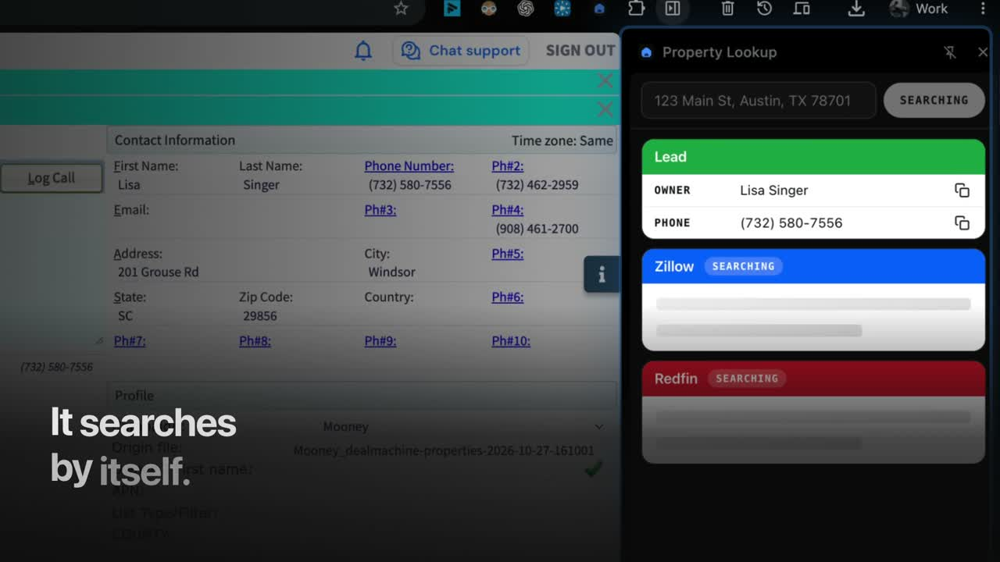

https://github.com/user-attachments/assets/4298f30f-1add-4913-a9de-7f6a09accf32

# Property Lookup

A Chrome extension. Give it an address and it shows the Zillow and Redfin price, beds, baths, size and links side by side. On ReadyMode it reads the lead's address for you.

*Click the picture to watch the 30-second demo.*

## Install

1. Download or clone this folder.
2. In Chrome, go to `chrome://extensions`.
3. Turn on **Developer mode** (top right).
4. Click **Load unpacked** and choose the `Property Lookup` folder.
5. Pin the extension from the puzzle-piece menu so the icon is easy to reach.

## Use

1. Click the Property Lookup icon. A side panel opens.
2. Enter your **RES-ID** and click **Log in**. This is needed once a week.
3. Get an address in one of two ways:
   - **On ReadyMode:** open a lead. The panel fills in the address and searches on its own. Each new lead searches again.
   - **Anywhere else:** type or paste an address like `123 Main St, Austin, TX 78701` and click **Look up**.
4. Wait a few seconds. You get a Lead card (owner and phone, ReadyMode only), a Zillow card and a Redfin card.

Each card shows bed/bath, estimate, whether it is listed, full address, type, zoning, square feet and a link to the listing. Use the copy icon next to any row, or **Copy all** on a card.

The higher estimate is highlighted green and the lower one red, so you can see the gap at a glance.

## If something shows up

- **Check needed:** Zillow or Redfin asked for a human check. Finish it in the window that opened, then click **Look up** again.
- **No match:** the site has no exact match for that address. Open the link to look yourself.
- **Could not reach the server / RES-ID not allowed:** check the ID with your admin, or check your internet.

## How it works

The extension opens Zillow and Redfin in a hidden minimized window, reads the listing data, and closes the window. Nothing is stored except your login and the latest result, both in your own browser.

| File | What it does |
|---|---|
| `manifest.json` | Extension settings and permissions |
| `sidepanel.html` / `sidepanel.js` | The panel, login and copy buttons |
| `background.js` | Runs the Zillow and Redfin lookups |
| `extract.js` | Pulls price, beds, baths etc. from the listing page |
| `readymode.js` | Reads address, owner and phone from a ReadyMode lead |

After you edit any file, go to `chrome://extensions` and click the reload icon on the extension.

Built by Mohamed Abdo.
